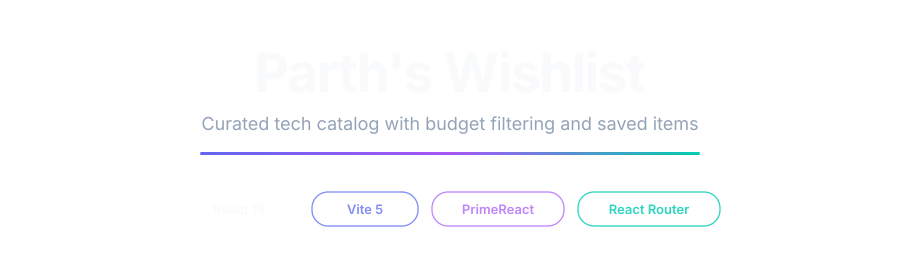
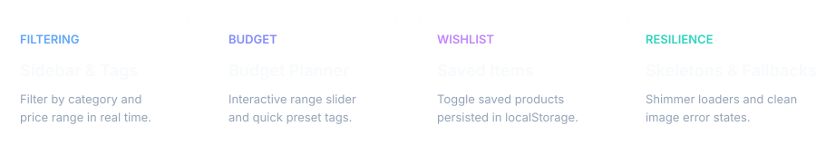
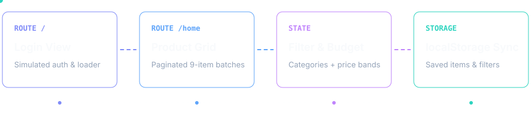

<div align="center">
  
</div>

A React + Vite product catalog and wishlist application featuring multi-criteria filtering, an interactive budget planner, `localStorage` persistence, and skeleton loading states.

## Features

<div align="center">
  
</div>

- **Sidebar Filtering:** Filter products by category (`Smartphones`, `Laptops`, `Headphones`, `TVs`, `Wearables`) and price ranges (`Under 1K`, `1k-5k`, `5k-10k`, `U10k-20k`, `More than 20k`).
- **Budget Planner:** Interactive modal with range slider and quick-select budget tags.
- **Saved Wishlist:** Save and toggle products with `localStorage` persistence (`savedProducts`, `selectedFilters`, `showingSaved`).
- **Paginated Grid & Fallbacks:** Loads products in batches of 9 with skeleton shimmer loaders and glassmorphism image-error fallbacks.

## Application Flow

<div align="center">
  
</div>

| Route | Component | Purpose |
|---|---|---|
| `/` | `src/Login.jsx` | Simulated login screen with password visibility toggle and loading spinner |
| `/home` | `src/Home.jsx` | Product catalog grid, filter sidebar, budget modal, and saved items view |
| `*` | `src/NotFound.jsx` | Fallback 404 route |

## Tech Stack

- **Framework:** React 18 + Vite 5
- **Routing:** `react-router-dom` v6
- **UI & Icons:** PrimeReact, PrimeFlex, PrimeIcons, Lucide React, React Icons

## Getting Started

```bash
# Install dependencies
npm install

# Start development server with HMR
npm run dev

# Build for production
npm run build

# Preview production build
npm run preview

# Run ESLint
npm run lint
```

<details>
<summary><b>Project Structure</b></summary>

<br/>

```text
wishlist/
├── index.html          # App shell ("Parth's Wishlist")
├── package.json        # Dependencies and Vite scripts
├── vite.config.js      # Vite configuration
└── src/
    ├── App.jsx         # Router setup and PrimeReact theme imports
    ├── Login.jsx       # Login page and loading transition
    ├── Home.jsx        # Product grid, filters, budget modal, saved state
    ├── products.jsx    # Catalog dataset
    ├── NotFound.jsx    # 404 page
    └── *.css           # Component and responsive stylesheets
```

</details>

<div align="center">
  
</div>
